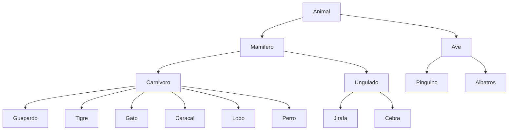

# Ontología — Práctica: Desarrollo de Predicados

**Instituto Tecnológico de Ensenada — Programación Lógica y funcional 2026-1**
Elaborada por: Guillermo Guzmán Mendoza, Bladimir Nava Vergara

Basado en las notas de la bióloga Ana Torres (reglas 1-12) y las reglas
nuevas de las entrevistas: Entrevista 1 (Gato vs. Caracal) y Entrevista 2 (Lobo).

## Diagrama jerárquico

## Reglas 1-12 (notas de la bióloga)

| # | Relación | Condición |
|---|---|---|
| 1 | Animal → Mamífero | tiene pelo |
| 2 | Animal → Mamífero | da leche a sus crías |
| 3 | Animal → Ave | tiene plumas |
| 4 | Animal → Ave | vuela Y pone huevos |
| 5 | Mamífero → Carnívoro | come carne |
| 6 | Mamífero → Ungulado | tiene pezuñas |
| 7 | Carnívoro → Guepardo | color leonado Y manchas oscuras |
| 8 | Carnívoro → Tigre | rayas negras |
| 9 | Ungulado → Jirafa | cuello largo Y manchas oscuras |
| 10 | Ungulado → Cebra | rayas negras |
| 11 | Ave → Pingüino | nada Y blanco y negro |
| 12 | Ave → Albatros | vuela muy bien |

## Reglas nuevas — Entrevista 1 (Guillermo): Gato vs. Caracal

| Relación | Condición |
|---|---|
| Carnívoro → Gato | tamaño pequeño Y NO tiene mechones en las orejas |
| Carnívoro → Caracal | tiene mechones en las orejas Y vive en estado salvaje |

## Reglas nuevas — Entrevista 2 (Bladimir): Lobo

| Relación | Condición |
|---|---|
| → Lobo | tiene hocico grande y firme |
| Carnívoro → Lobo | vive en manada (en estado salvaje) |

> **Nota:** el documento no formaliza una regla derivada para **Perro(x)**;
> en la entrevista 2 solo se dieron reglas para Lobo. Por eso, en el script
> de Python, `Perro` se maneja como un hecho base directo y no como una
> regla derivada de otras características.

## Correspondencia con el código Python

- Los **hechos base** de cada animal están en el diccionario `hechos` de `hechos_animales.py`.
- Cada **relación/regla** de las tablas de arriba corresponde a una función
  (`Mamifero()`, `Carnivoro()`, `Gato()`, `Lobo()`, etc.) que consulta esos hechos.
- El diagrama Mermaid corresponde a la lista de tuplas `vinculos_jerarquia` del script.